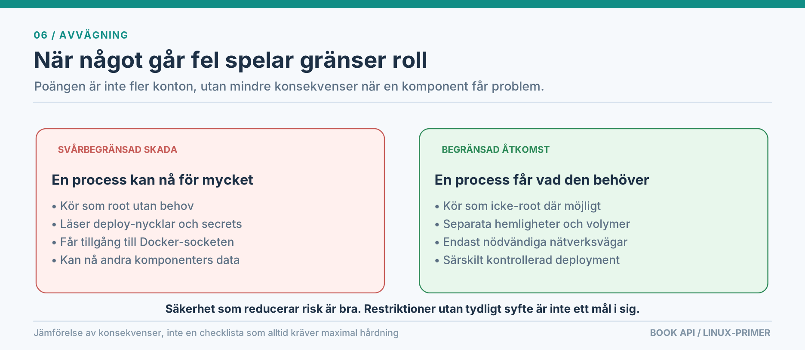
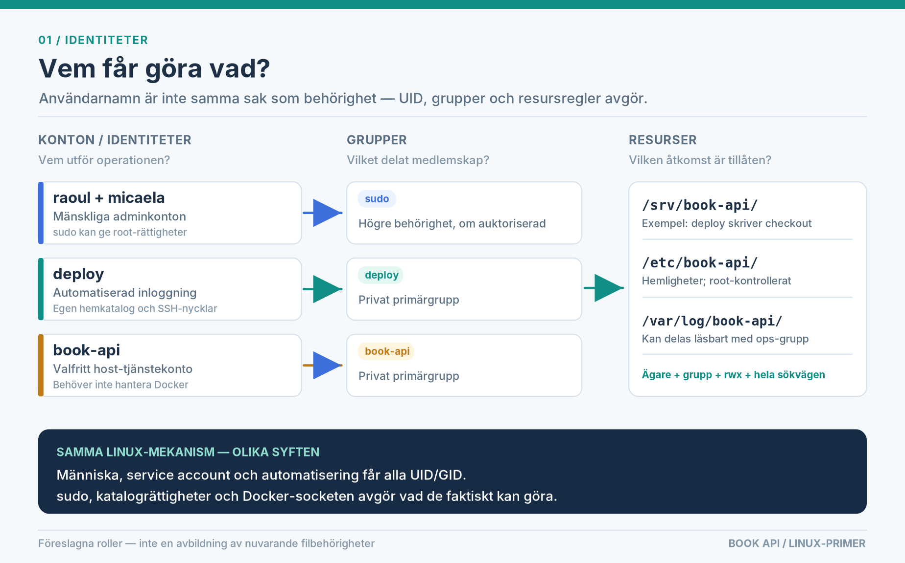
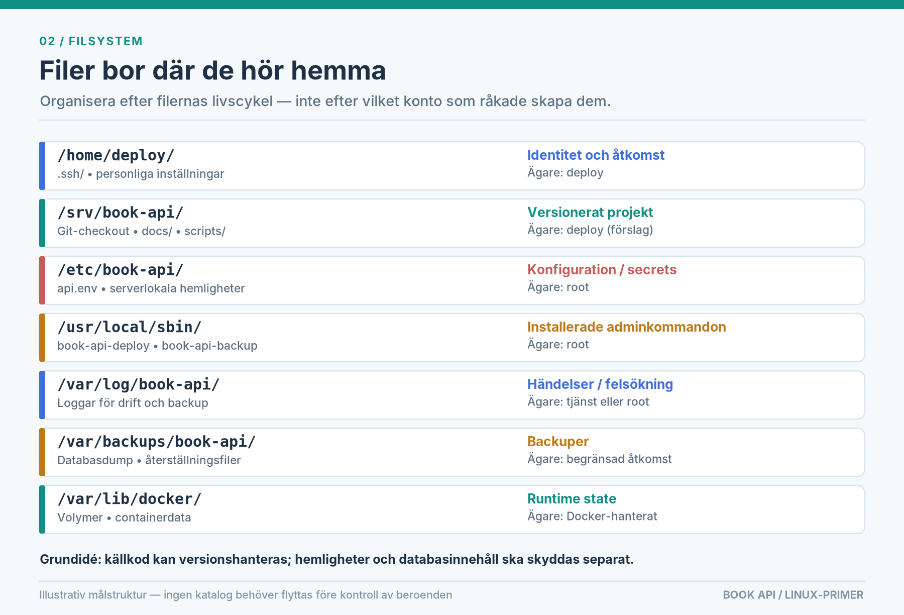
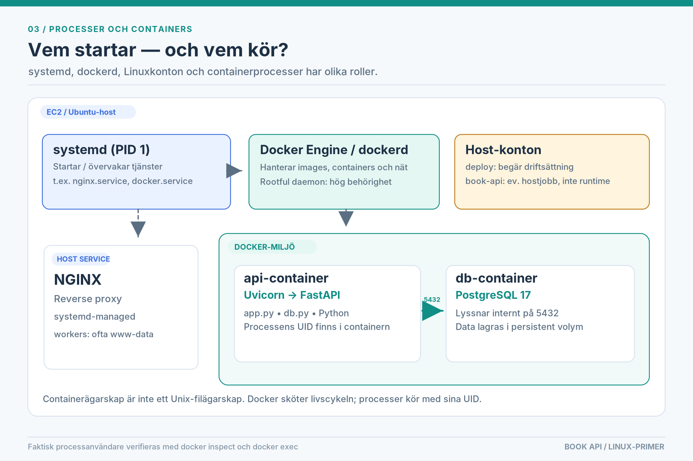
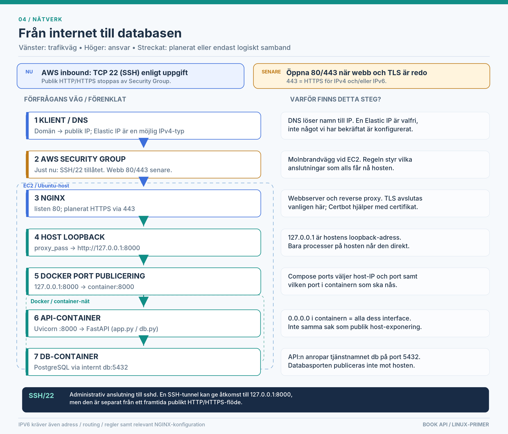
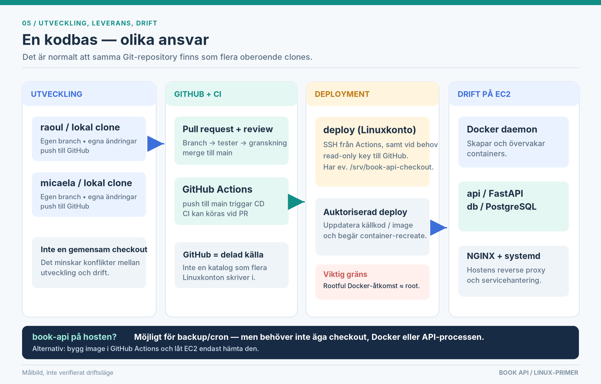

# Linuxadministration baserat på hemtentan

**Varför konton, rättigheter, portar och deployment hålls isär***En illustrerad repetition för utvecklare — med vårt Book API på Ubuntu/EC2 som exempel.*

> **Grundtanke:** Linuxsäkerhet handlar till stor del om att **varje komponent ska behöva så lite förtroende som möjligt**. Säkerhetsåtgärder ska **minska faktisk risk**, inte bara skapa mer administration.

**Läs detta som en karta, inte som ett facit.** En liten kursserver kan ha enklare rutiner än en produktionsmiljö. Bra administration handlar om att förstå konsekvensen av ett val och kunna motivera det.

**Status i exemplen:** *Nu* betyder sådant vi har sett i kommandoutskrifter eller konfiguration: Linuxkontot `book-api`, Git-checkout under `/home/book-api/`, två körande Docker-containers, NGINX med `listen 80` och proxy mot `127.0.0.1:8000`. Enligt vår senaste uppgift tillåter AWS Security Group bara inkommande **TCP/22**. *Målbild* betyder förslag: `deploy`, `/srv/book-api/`, GitHub Actions och publik HTTP/HTTPS. Detta är **inte** en verifierad inventering av alla serverinställningar.

---

## 1. Varför känns säkerhet ibland som extraarbete?

En enda användare med fulla rättigheter kan installera, bygga och starta nästan allt utan hinder. Men om en process får fel, ett beroende (dependency) blir komprometterat eller ett script skriver på fel plats kan skadan spridas långt. Att dela upp ansvar minskar **spridningsytan (*blast radius*)** när något går fel.

Skillnaden ligger inte alltid i att förhindra felet — utan i **vad felet kan komma åt**. Därför är det värdefullt att skydda hemligheter, undvika onödig root-körning och öppna endast nödvändiga nätverksvägar.



> *Exempel / avvägning:* Ett extra konto utan särskilt ansvar ger sällan bättre säkerhet. Två tydliga roller med förståeliga rättigheter kan vara säkrare **och** lättare att sköta än sex konton med oklara undantag.

## 2. Identiteter: användare, service accounts och grupper

För Linux är en människa och ett **service account** i grunden båda användaridentiteter med **UID** (user ID), primär **GID** (group ID), eventuella extragrupper och en uppsättning behörigheter. Orden beskriver **avsikten med kontot**. En systemanvändare skapas ofta utan vanlig inloggning, men det är inte ett krav för att ett konto ska användas av en tjänst.

- **`ubuntu`, `raoul`, `micaela`:** Människokonton för administration/utveckling. `sudo` kan ge tillfällig root-behörighet.
- **`deploy` (målbild):** Konto som autentiserar och utför godkända deployment-operationer. Behöver sannolikt en hemkatalog för SSH-nycklar, men inte automatiskt ett vanligt lösenord eller generell `sudo`.
- **`book-api` (finns nu):** Ett host-konto med egen primärgrupp. Om applikationen kör helt i Docker kan det bli överflödigt för själva driften, men befintliga backup-/cron-jobb måste kontrolleras först.
- **`root`:** Administrativ identitet (UID 0). **`systemd` är däremot en service manager, inte en användare.**



En egen primärgrupp som heter `book-api` är normal och krockar inte med exempelvis `bookdev`. Grupper behövs när flera identiteter ska dela **en viss resurs** — inte för att alla i ett projekt måste finnas i samma grupp. Vem som kan använda en fil styrs av **ägare, grupp, `rwx`-bitar och rättigheter längs hela sökvägen**. `2750` på en katalog betyder bland annat **setgid** (nya filer/kataloger ärver normalt gruppen), men **inte** att gruppen får skriva.

**Två användbara kontroller:**

```bash
getent passwd book-api              # UID, GID, home, shell
sudo passwd -S book-api              # P, L eller NP: lösenordsstatus
```

I vår miljö har `book-api` `/bin/bash`, men lösenordsstatus **`L`**: lösenordsautentisering är låst. Därför misslyckas vanliga `su book-api` ofta, medan en sudo-auktoriserad administratör kan köra `sudo -u book-api <kommando>`. Låst lösenord hindrar inte i sig processkörning eller nödvändigtvis SSH-nyckelinloggning. Det är ingen anledning att ge servicekontot ett lösenord.

> *Exempel / avvägning:* `chmod 777` löser ofta ett omedelbart behörighetsfel men ger alla lokala användare mycket bred åtkomst. Kontrollera först **varför** rättigheterna nekas. `sudo`, gruppmedlemskap och katalogens sökväg kan vara det faktiska problemet.

## 3. Filernas hemvist: kod, hemligheter och driftdata

Linuxkataloger organiseras ofta efter **vilken sorts data** de innehåller:



`/home` är kontospecifikt; `/srv` kan innehålla en utplacerad tjänst; `/etc` är lämpligt för host-konfiguration; `/var/log` för loggar; `/var/backups` för säkerhetskopior; och Docker hanterar sin egen lagring (ofta under `/var/lib/docker`, beroende på installation). Det är **konventioner**, inte magiska kataloger med automatiska säkerhetsregler.

Vårt repo ligger **nu** under `/home/book-api/mlo26-linux-hemtenta-micaela-raoul/`. En **möjlig** uppdelning senare är `/srv/book-api/` för en deploy-styrd checkout, `/etc/book-api/` för host-hemligheter och `/var/backups/book-api/` för backuper. Flytta **inte** något förrän Compose-filens relativa sökvägar, volymer, SSH-nycklar och cron-jobb har granskats.

**Dokument och scripts kan absolut ligga kvar i Git.** `docs/` är kunskap och `scripts/` är versionshanterad källkod till verktyg. Ett privilegierat, installerat script kan däremot ligga i `/usr/local/sbin/` och ägas av `root`, med separat godkännande av uppdateringar. En root-körd wrapper är **inte säker** om `deploy` fritt kan ändra dess script eller privilegierade Compose-konfiguration.

```bash
namei -l /home/book-api/mlo26-linux-hemtenta-micaela-raoul
stat -c '%U:%G %A %n' /home/book-api
```

`namei -l` visar **varje katalogleds** rättigheter; `stat` visar ägare, grupp och läsbara mode-bitar. För att använda en sökväg behöver man normalt `x` (traversering) på varje överordnad katalog.

> *Exempel / avvägning:* En `.env` med mode `600` är bra, men ett konto som får skriva i **föräldrakatalogen** kan ibland ersätta filen. Skydda även den katalog som innehåller produktionshemligheter. Databasbackuper bör på sikt finnas **utanför samma EC2-instans**.

## 4. Processer: systemd är inte Docker, och Docker är inte `book-api`

**systemd** startar och övervakar systemtjänster, till exempel `nginx.service` och `docker.service`. **Docker Engine (`dockerd`)** skapar och hanterar containers. **Docker Compose** är deklarationen av vilka tjänster, nätverk, portar och volymer vi vill ha. Att ett Linuxkonto har klonat repot betyder **inte** att kontot äger containrarna.



I vårt Book API finns två körande containers:

- **`api`:** Python, Uvicorn (ASGI-server), FastAPI och vår kod (`app.py`, `db.py`, …).
- **`db`:** PostgreSQL 17, med persistent data i en Docker-volym eller annan monterad lagring (kontrollera exakt mount).

En containerprocess har en **egen användaridentitet som kan konfigureras i image/Compose**. Den behöver inte motsvara ett host-konto som heter `book-api`. Däremot är **rootful Docker mycket privilegierat**: att styra Docker-socketen eller få obegränsad `docker`-gruppåtkomst motsvarar i praktiken omfattande root-kontroll.

**Två snabba diagnoser:**

```bash
systemctl status nginx
sudo docker ps
```

**När processen behöver identifieras:** `sudo docker inspect <api-container> --format '{{.Config.User}}'` visar konfigurerad användare (kan vara tom), och `sudo docker exec <api-container> id` visar effektiv identitet i en körande container.

## 5. Portar och nät: varför två stycken `8000` inte betyder dubbel exponering

Vi har sett dessa delar av konfigurationen:

```yaml
# docker-compose.yml (utdrag)
ports:
  - "127.0.0.1:8000:8000"
```

```nginx
# Aktiv NGINX-konfiguration (utdrag)
listen 80;
server_name 13.51.232.9;
location / { proxy_pass http://127.0.0.1:8000; }
```

Det betyder: **NGINX lyssnar på hostens HTTP-port 80**, och skickar förfrågningar till **hostens loopback** `127.0.0.1:8000`. Docker publicerar just det host-endpointet mot **port 8000 i API-containern**. Uvicorn lyssnar där normalt på `0.0.0.0:8000` **inne i containern**, inte automatiskt på alla offentliga nätverksinterface på EC2. `db.py` är Pythonkod som pratar med PostgreSQL; själva databasen är den **andra** containern och nås normalt via Compose-namnet **`db:5432`** på det interna nätet.



**Viktig skillnad mellan nu och senare:** NGINX kan lyssna på port 80 **på hosten** även när AWS Security Group fortfarande stoppar inkommande HTTP utifrån. Enligt vår uppgift är bara SSH/**22** öppet i AWS i nuläget. Port **443 är HTTPS, inte en IPv6-port**: samma port används för IPv4 och IPv6. IPv6 kräver dessutom tilldelad adress, routing, separata Security Group-regler (t.ex. `::/0` där det är motiverat) och relevant NGINX-konfiguration. DNS och en eventuell **Elastic IP** är adress-/namnfrågor; vi har **inte bekräftat** att den aktuella publika IPv4-adressen är en Elastic IP. Certbot hanterar certifikat och Fail2Ban kan tillämpa loggbaserade blockeringar; ingen av dem är en vanlig vidarebefordringsstation i HTTP-flödet.

```bash
sudo ss -ltnp   # Vilka processer lyssnar på TCP, och på vilka adresser?
sudo nginx -t   # Är NGINX-konfigurationen syntaktiskt giltig?
```

> *Exempel / avvägning:* Att publicera PostgreSQL på `0.0.0.0:5432` skulle öka angreppsytan om extern DB-åtkomst inte krävs. En intern Compose-anslutning är normalt enklare och säkrare här. En **AWS Security Group** styr vad som når instansen; den ersätter inte bind-adresser och andra skydd på hosten.

## 6. GitHub, CI/CD och `deploy`: tre steg, inte en delad mapp

**Utveckling:** Var och en arbetar i sin **egen** lokala Git-clone. GitHub är den delade källan. **CI:** En pull request kan utlösa tester och build-kontroller. **CD:** En merge/push till `main` kan utlösa ett GitHub Actions-workflow som utför en **auktoriserad** deployment till EC2. `deploy` är då en **Linuxidentitet**, inte en daemon som måste vara igång hela tiden.



En SSH-baserad modell kan använda **två olika nyckelpar**: ett för **GitHub Actions → EC2 (`authorized_keys`)**, ett annat, läsbehörigt deploy-key, för **EC2 → GitHub (`git fetch`)**. `deploy` kan äga `/srv/book-api/` om servern ska klona och bygga koden där. `raoul` och `micaela` behöver inte skriva i den **driftsatta** checkouten; de har egna clones och kan ändå administrera hosten via `sudo`.

**Två rimliga ambitionsnivåer:**

| Enklare kursflöde                                                                | Mer avgränsat flöde                                                              |
| --------------------------------------------------------------------------------- | ---------------------------------------------------------------------------------- |
| Actions startar ett betrott deployment-steg på EC2; Compose bygger/startar där. | Actions testar och bygger image; EC2 hämtar en godkänd image från ett registry. |
| Färre delar att lära och felsöka.                                              | Bättre separation mellan build och runtime, men mer konfiguration.                |

I båda fallen måste privilegierna vara **medvetna**. Om `deploy` kan ändra `docker-compose.yml` och få den körd med obegränsad Docker-åtkomst är `deploy` i praktiken **högt privilegierat**, även utan generell `sudo`. Det kan vara ett medvetet kursval, men ska inte beskrivas som en strikt säkerhetsgräns. Använd PR-granskning, tester och kända versions-ID:n; förhindra parallella deployments när det behövs.

> *Exempel / avvägning:* Flytten från `/home/book-api/...` till `/srv/book-api/` kan ändra Compose **project name** och därmed skapa **nya** containers och **nya databasvolymer**. Kontrollera Compose-namn och mounts först. Kör inte `docker compose down -v` på en databas vars data ni vill bevara.

## 7. Snabbkarta för felsökning

När något inte fungerar, fråga först **vilken gräns** som nekar åtkomst: konto, fil, tjänst, host-nät, molnbrandvägg eller container-nät?

| Fråga                                  | Ett användbart kommando                  |
| --------------------------------------- | ----------------------------------------- |
| Vem äger processen?                    | `ps -eo user,pid,ppid,comm`             |
| Varför kommer jag inte in i katalogen? | `namei -l /sökväg/till/katalog`       |
| Vilka tjänster lyssnar på TCP?        | `sudo ss -ltnp`                         |
| Kör NGINX och rapporterar den fel?     | `systemctl status nginx`                |
| Vilka Compose-projekt körs?            | `sudo docker compose ls --all`          |
| Vilken user/mount använder containern? | `sudo docker inspect <namn>`            |
| Är Git-checkouten ändrad?             | `git -C /sökväg/till/repo status -sb` |

**Tre frågor före varje ny rättighet:** (1) *Vad måste komponenten faktiskt kunna göra?* (2) *Vad kan gå fel om den får mer åtkomst?* (3) *Är åtgärden värd administrationen den kräver?*

---

### Fördjupning från primärkällor

- [GitHub Docs – diagram och Mermaid i Markdown](https://docs.github.com/en/get-started/writing-on-github/working-with-advanced-formatting/creating-diagrams) — SVG/PNG i detta dokument kräver ingen Mermaid-installation.
- [Docker Docs – Publicera portar](https://docs.docker.com/get-started/docker-concepts/running-containers/publishing-ports/) och [nätverk i Compose](https://docs.docker.com/compose/how-tos/networking/).
- [AWS EC2 – Security Group-regler](https://docs.aws.amazon.com/AWSEC2/latest/UserGuide/security-group-rules-reference.html).
- [systemd – `User=` och `Group=`](https://www.freedesktop.org/software/systemd/man/latest/systemd.exec.html).
- [GitHub Docs – Deployment med Actions](https://docs.github.com/en/actions/how-tos/deploy/configure-and-manage-deployments/control-deployments).

*Alla diagram finns även som skalbara `.svg` under `docs/assets/` och kan öppnas separat. Bildtexter och rekommendationer är pedagogiska förenklingar; verifiera alltid faktisk konfigurering innan ni ändrar en körande tjänst.*
